 

     

## 👋 Hello, I'm Blevis

AI student focused on machine learning, NLP and deep learning. I build ML pipelines in Python.

## 🛠 Currently working on

<table>
  <tr>
    <td width="50%" align="center">
      
    </td>
    <td width="50%" align="center">
      
    </td>
  </tr>
</table>

## 💻 Tech stack

**Languages**

        

**Frameworks**

**Documentation**

 

## 📊 GitHub stats

 

### ✍️ Random dev quote

