


 

 


  
  

> **I'm an Artificial Intelligence student who treats machine learning as an engineering discipline.**
> I care about the unglamorous parts that decide whether a model is worth trusting: clean data contracts,
> leak-free splits, honest baselines, confidence intervals, and tests that keep it all from rotting.
> My work spans **statistical ML**, **NLP**, and **classic algorithms**, and it usually ends with something
> people can actually open: a site, an app, or a paper-style report.

 



 


  <a href="https://github.com/Blevis/White_Lies-Is_the_First-Move_Advantage_Real"></a>
  <a href="https://github.com/Blevis/Fairfare"></a>

  <a href="https://github.com/Blevis/SpracheNLP"></a>
  <a href="https://github.com/Blevis/RouteForge"></a>

  <a href="https://github.com/Blevis/ZigZiggy"></a>
  <a href="https://github.com/Blevis/PlayOps"></a>

<b>🧪 Machine Learning track: the full lab log</b> (click to expand)

 

| Module | What it covers | Repo |
|:--|:--|:--:|
| **Linear Algebra** | vectors, matrices and the operations under every model | [→](https://github.com/Blevis/Holberton-ML-Linear-Algebra) |
| **Probability** | distributions, sampling, and expectation from first principles | [→](https://github.com/Blevis/Holberton-ML-Probability) |
| **Pandas** | tabular wrangling, indexing, grouping and reshaping | [→](https://github.com/Blevis/Holberton-ML-Pandas) |
| **Plotting** | Matplotlib figures that explain rather than decorate | [→](https://github.com/Blevis/Holberton-ML-Plotting) |
| **Data Collection: APIs** | pulling structured data from REST endpoints | [→](https://github.com/Blevis/Holberton-ML-Data-Collection-APIs) |
| **Web Scraping** | turning messy HTML into clean datasets | [→](https://github.com/Blevis/Holberton-ML-Web-Scraping) |
| **Data Prep & Visualization** | cleaning, feature prep and exploratory analysis | [→](https://github.com/Blevis/Holberton-ML-Data-Preparation-And-Visualization) |
| **Rock · Paper · Scissors** | gesture recognition with a Teachable Machine model | [→](https://github.com/Blevis/Holberton-ML-RockPaperScissors) |

 



 


**Languages**

**Machine learning & data**

**Build, ship & document**

 


  
  

  

  

 


  


The visuals on this page can be generated from <a href="assets/src/build_assets.py"><code>assets/src/build_assets.py</code></a>.

